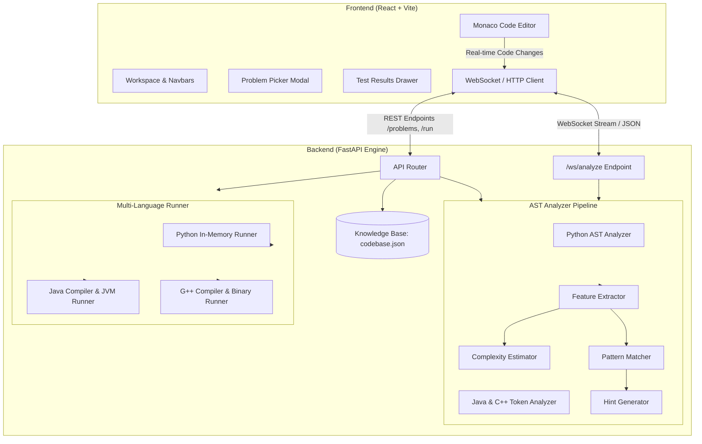

# SCRS (Smart Code Review System)

<div align="center">


<br/>

**A Real-Time AST-Powered Algorithmic Pattern Reviewer, Complexity Estimator, and DSA Practice IDE**

[](https://fastapi.tiangolo.com)
[](https://react.dev)
[](https://vitejs.dev)
[](https://microsoft.github.io/monaco-editor/)
[](https://www.python.org/)
[](https://openjdk.org/)
[](https://isocpp.org/)
[](https://github.com)
[](LICENSE)

</div>

---

## 📌 Overview

**SCRS (Smart Code Review System)** is a deterministic, offline-capable DSA development and code-review environment. Designed for serious LeetCode / NeetCode 75 practice, SCRS provides **instant, real-time AST feedback** on your code as you type—without relying on rate-limited, expensive, or non-deterministic third-party LLMs.

As you write code in **Python**, **Java**, or **C++**, the system parses syntax trees, detects high-level algorithmic paradigms, computes asymptotic loop nesting and auxiliary memory bounds, verifies test cases, and provides progressive hints when you are stuck.

---

## ✨ Key Features

### 1. ⚡ Real-Time Multi-Language AST Analysis
* **Python**: Native `ast` module parsing with syntax validation, recursive depth calculation, and collection metric extraction.
* **Java & C++**: Token-based bracket tracers, comment/literal sanitizers, method signature matchers, and structural loop depth trackers.
* **WebSocket Streaming**: Continuous analysis stream via `ws://127.0.0.1:8000/ws/analyze` with debounced POST fallback for low-latency feedback.

### 2. 🧠 Algorithmic Pattern Recognition
Automatically detects canonical algorithmic strategies with synchronized diagnostic evidence across all three languages:
* **Two Pointers**: Inward scans, symmetric convergence, sorted pair checks.
* **Sliding Window**: Dynamic expansion/shrink windows, fixed-size frequency windows.
* **Prefix Sums**: Running totals, prefix/suffix arrays, subarray sum lookups.
* **Binary Search**: Midpoint calculations (`l + (r - l) / 2`), search space halving.
* **Monotonic Stack / Queue**: Next greater element lookups, histogram expansion, temperature scans.
* **Dynamic Programming**: Kadane’s algorithm, Fibonacci state rolls, memoized recursion, bottom-up tabulations.
* **Graph & Tree Traversals**: DFS recursion, BFS queue exploration, topological sorting, connected components.
* **Hashing & Membership**: Constant-time dictionary lookups and set membership checks.

### 3. ⏱️ Deterministic Big-O Complexity Estimation
* **Time Complexity**: Evaluates loop nesting depth, halving steps, recursive branch factors, and sorting operations to categorize time as $O(1)$, $O(\log n)$, $O(n)$, $O(n \log n)$, $O(n^2)$, or $O(2^n)$.
* **Space Complexity**: Identifies memory allocations (arrays, lists, hash maps, queues, stack recursion frames) and measures auxiliary space against the problem's theoretical optimal goal.

### 4. 📚 75 Curated DSA Problems
* Fully curated canonical problem set covering Arrays, Strings, Two Pointers, Sliding Window, Linked Lists, Trees, BSTs, Graphs, Dynamic Programming, and Backtracking.
* **Comprehensive Metadata**: In-depth problem descriptions, $\ge 2$ structured examples (Inputs, Outputs, and step-by-step Explanations), and explicit mathematical constraints for every problem.
* **Type-Safe Starters**: Verified boilerplate codes for Python, Java, and C++ with 0 syntax errors.
* **Distinct Brute vs. Optimal Templates**: Every single problem includes an authentic **Brute Force** ($O(n^2)$, $O(n^3)$, simulation) template and an **Optimal Solution** template, formatted with explicit curly braces `{ ... }` and standard 4-space indentation.

### 5. 🧪 Tri-Language Sandbox Test Runner
* Executes submissions against multiple edge-case and functional test scenarios.
* Returns detailed test diagnostics: Pass/Fail status, expected vs. actual output, runtime in milliseconds, and structured compiler error traces.

### 6. 💡 3-Tier Progressive Hint System
Step-by-step guidance that teaches problem solving without spoiling the full code upfront:
* **Level 1 — The Performance Bottleneck**: Reveals inefficiencies in naive brute force operations.
* **Level 2 — Data Structure Selection**: Recommends the optimal data structure to unlock sub-quadratic lookups.
* **Level 3 — Algorithm Blueprint**: Explains invariant rules, two-pointer boundaries, and inductive steps.

### 7. 💻 High-Productivity Monaco IDE
* **Monaco Editor Studio**: VS Code dark theme, ligature support, smooth cursor animation, bracket pair colorization, and auto-indentation.
* **Smart Insertion Auto-Focus**: Automatically places the typing cursor directly inside the method body (highlighting `pass` in Python or inside `{ ... }` in Java/C++) upon problem selection or language switch.
* **Font Remeasurement**: Pixel-perfect cursor alignment powered by preloaded `JetBrains Mono` and browser font listener integration.
* **Keyboard Shortcuts**:
  * `Ctrl+Enter` / `Cmd+Enter`: Run tests against test cases.
  * `Ctrl+K` / `Cmd+K`: Open the Problem Search & Filter modal.
  * `Esc`: Close open modal windows.

---

## 🏛️ System Architecture



---

## 📁 Repository Structure

```
Intellicode/
├── backend/
│   ├── app/
│   │   ├── analyzer/
│   │   │   ├── analyzer.py              # Central AST analysis coordinator
│   │   │   ├── complexity_estimator.py  # Big-O time and space inference engine
│   │   │   ├── feature_extractor.py     # Python AST loop, recursion & collection extractor
│   │   │   ├── multi_lang_analyzer.py   # Java & C++ token-based bracket/metric parser
│   │   │   ├── pattern_matcher.py       # Canonical algorithmic pattern classification
│   │   │   ├── pattern_registry.py      # Pattern names, targets, and evidence definitions
│   │   │   ├── hashing_detector.py      # Map/Set usage detector
│   │   │   └── hint_generator.py        # 3-tier progressive hint generator
│   │   ├── curated_problems_data.py     # Descriptions, examples, constraints & starter codes
│   │   ├── curated_brute_codes.py       # Curated Brute Force implementations
│   │   ├── knowledge_base.py            # Knowledge base repository & schema validator
│   │   ├── runner.py                    # Multi-language test runner (Python, Java, C++)
│   │   └── main.py                      # FastAPI application, REST endpoints & WebSocket
│   ├── tests/
│   │   ├── test_analyzer.py             # AST metrics & pattern classification tests
│   │   ├── test_full_system.py          # End-to-end integration & runner tests
│   │   ├── test_hashing_detector.py     # Hash map and set detection tests
│   │   └── test_pattern_registry.py     # Registry completeness tests
│   └── requirements.txt                 # Backend Python dependencies
├── frontend/
│   ├── src/
│   │   ├── pages/
│   │   │   └── CodeEditor.jsx           # Main IDE component, Monaco Editor, Panels
│   │   ├── App.jsx                      # ErrorBoundary and Route configuration
│   │   ├── App.css                      # Global layout resets
│   │   ├── index.css                    # Design tokens, themes, buttons & cards
│   │   └── main.jsx                     # Application entry point
│   ├── index.html                       # HTML root with JetBrains Mono font preloads
│   ├── package.json                     # Frontend dependencies and build scripts
│   └── vite.config.js                   # Vite configuration
├── codebase.json                        # 75 Canonical Blind/NeetCode problems database
├── scripts/
│   ├── audit_knowledge_base.py          # Validates problem schema, constraints & approaches
│   ├── check_approaches.py              # Audits Brute vs Optimal approaches
│   ├── find_duplicate_presets.py        # Verifies 0 duplicate presets across all 75 problems
│   └── verify_all_patterns_and_starters.py # Validates 0 starter syntax errors & patterns
└── README.md
```

---

## 🚀 Quick Start Guide

### Prerequisites
* **Python**: 3.10 or higher
* **Node.js**: 18.0 or higher (`npm` included)
* *(Optional for local Java / C++ execution)*: `javac` (JDK 17+) and `g++` (GCC 11+) in your system PATH.

---

### Step 1: Backend Setup

```bash
# 1. Navigate to backend directory
cd backend

# 2. Create and activate a Python virtual environment
# On Windows (PowerShell):
python -m venv .venv
.venv\Scripts\Activate.ps1

# On macOS/Linux:
python3 -m venv .venv
source .venv/bin/activate

# 3. Install backend dependencies
pip install -r requirements.txt

# 4. Start the FastAPI backend server
python -m uvicorn app.main:app --host 127.0.0.1 --port 8000 --reload
```

> **Backend is now listening on:** `http://127.0.0.1:8000`  
> **Interactive Swagger Documentation:** `http://127.0.0.1:8000/docs`

---

### Step 2: Frontend Setup

Open a new terminal window:

```bash
# 1. Navigate to frontend directory
cd frontend

# 2. Install Node dependencies
npm install

# 3. Launch Vite development server
npm run dev
```

> **Frontend application is now live at:** `http://localhost:5173`

---

## 🧪 Testing & Verification

The codebase includes automated test suites covering AST parsing, pattern recognition, complexity bounds, and code runners.

### Run Backend Unit & Integration Tests
```bash
cd backend
python -m pytest tests -v
```
*(Expected: 44 passed in < 0.5s)*

### Verify All 75 Problems & Starter Codes
```bash
python scripts/verify_all_patterns_and_starters.py
```
*(Validates: 0 metadata issues, 0 starter syntax errors, 0 starter pattern mismatches across Python, Java, and C++)*

### Verify Brute Force vs. Optimal Approach Uniqueness
```bash
python scripts/find_duplicate_presets.py
```
*(Expected: 0 duplicate presets across all 75 problems)*

### Validate Production Frontend Build
```bash
cd frontend
npm run build
```
*(Bundles clean production artifacts in `dist/` with 0 warnings or type errors)*

---

## 📡 API Reference

### Problem Management
| Method | Endpoint | Description |
|---|---|---|
| `GET` | `/health` | Server health check status. |
| `GET` | `/problems` | Returns list of all 75 problems with difficulty, category, and pattern tags. Query params: `difficulty`, `category`, `pattern`, `q`. |
| `GET` | `/problems/{id}` | Returns complete problem specification: description, examples, constraints, starter codes, and test cases. |
| `GET` | `/problems/{id}/approaches` | Returns all theoretical approaches (Brute Force, Optimal, etc.) for problem `{id}`. |

### Analysis & Execution
| Method | Endpoint | Description |
|---|---|---|
| `POST` | `/analyze` | Analyzes code snippet. Returns syntax validity, detected algorithmic pattern, time/space complexity, structural metrics, and hints. |
| `WS` | `/ws/analyze` | Real-time WebSocket connection for low-latency code review while typing. |
| `POST` | `/run` | Compiles and executes code against problem test cases. Supports `python`, `java`, and `cpp`. |

#### Sample Request to `/run`:
```json
{
  "code": "class Solution:\n    def twoSum(self, nums: list[int], target: int) -> list[int]:\n        seen = {}\n        for i, x in enumerate(nums):\n            diff = target - x\n            if diff in seen:\n                return [seen[diff], i]\n            seen[x] = i\n        return []",
  "problem_id": 1,
  "language": "python"
}
```

#### Sample Response from `/run`:
```json
{
  "success": true,
  "passed": 3,
  "total": 3,
  "runtime_ms": 1.42,
  "results": [
    {
      "test_case": 1,
      "status": "PASS",
      "input": "nums = [2, 7, 11, 15], target = 9",
      "expected": "[0, 1]",
      "actual": "[0, 1]"
    }
  ]
}
```

---

## ⌨️ IDE Keyboard Shortcuts

| Shortcut | Action | Description |
|---|---|---|
| `Ctrl + Enter` / `Cmd + Enter` | **Run Code** | Executes current editor code against all test cases. |
| `Ctrl + K` / `Cmd + K` | **Search Problems** | Opens problem search, topic filtering, and difficulty selector modal. |
| `Escape` | **Close Modal** | Dismisses the problem search modal. |
| `Tab` / `Shift + Tab` | **Indent / Outdent** | Standard 4-space indentation control. |

---

## 🛠️ Technology Stack

* **Frontend**: React 18, Vite 5, Monaco Editor (`@monaco-editor/react`), React Router 6, React Icons, Vanilla Modern CSS.
* **Backend**: FastAPI, Uvicorn, Python AST Parser, Pydantic, WebSockets.
* **Compilers & Runtimes**: Python 3.10+, Java OpenJDK (`javac`), GNU C++ (`g++`).
* **Design & Typography**: JetBrains Mono (code font), Inter (UI font), VS Dark Monaco Palette, Glassmorphism accents.

---

## 📄 License

This project is open-source and licensed under the [MIT License](LICENSE).